<div align="center">

# Pit Wall

### An interactive Formula 1 telemetry, strategy and race-control dashboard

Every session from 2023 to 2026, F1 history back to 1950 · a strategy simulator, live race centre and an AI race engineer · built on FastF1, FastAPI and Next.js · re-themes itself in the colours of the team you're watching

[](https://github.com/ultron513/F1-Telemetry-Dashboard-2025/actions/workflows/ci.yml)


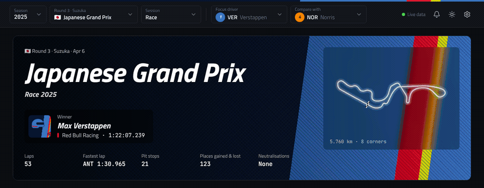

<sub>Pick a driver and the whole dashboard cross-fades into their team's colours.</sub>

[**Tour**](#-take-the-tour) · [**Ask the pit wall**](#ask-the-pit-wall) · [**How it works**](#-how-it-works) · [**The analytics**](#-the-analytics-explained) · [**API**](#-api-reference) · [**Run it**](#-run-it-locally) · [**Deploy**](#-deploy) · [**Project layout**](#-project-layout)

</div>

---

## 🏁 At a glance

| | |
| --- | --- |
| **Seasons** | 2023, 2024, 2025, 2026 — every practice, sprint, qualifying and race session |
| **Pages** | Overview · Ask the pit wall · Live · Telemetry · Lap analysis · Track map · Strategy · Simulator · Driver & car · Head to head · Race control · Weather · Standings · Team-mates · History · Drivers · Settings · Status |
| **AI race engineer** | Ask questions in plain English (*"why did Norris finish behind Verstappen?"*) and get answers worked out from the data, with the charts that prove them. An automatic report writes up every session. Works with Claude, OpenAI or Llama — or with no API key at all |
| **Strategy simulator** | A tyre and fuel model fitted on each race's own laps; re-run the race with any plan, Monte Carlo the safety cars, rank every 1- and 2-stop plan, and test any undercut |
| **Live race centre** | F1's live-timing feed over WebSockets (or any past race replayed as live): win and podium odds, where each car rejoins if it pits now, and alerts |
| **Driver & car analysis** | Corner-by-corner driving style, the ideal lap, what each car is built for, and who looks after their tyres |
| **History** | Champions, any driver's career and every circuit's pole times since 1950 |
| **Charts** | All hand-built in SVG: stacked telemetry traces with synced crosshair and zoom, circuit maps, tyre-strategy Gantt, race trace, box plots, radar, wind rose |
| **Live feel** | A session replay with every car on the map, a timing tower, Safety Car / VSC / red-flag banners and race-control messages arriving as notifications |
| **Shareable** | Season, round, session, drivers and laps live in the URL — every view can be bookmarked |
| **Themes** | 15 team themes (2023–2026 constructors) · dark and light mode · km/h or mph · °C or °F |
| **Engineering** | Parquet + DuckDB season warehouse · Redis/RQ job workers · OpenTelemetry tracing, Prometheus metrics and a status page · Playwright end-to-end and visual tests · a typed Python SDK |

---

## 🗺 Take the tour

Click any section to open it.

<details open>
<summary><b>Overview</b> — the result, the focus driver and the season so far</summary>
<br>

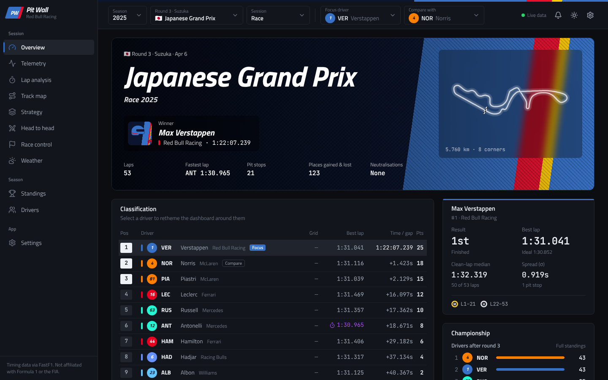

- The event name sits on a livery band in the focused team's colours, with the circuit outline beside it.
- The classification is a timing tower — **click any row** to focus that driver and re-theme every page.
- The side panels show the focused driver's result, best and ideal laps, consistency and stints, plus the championship after this round.
- The season calendar along the bottom jumps between rounds.

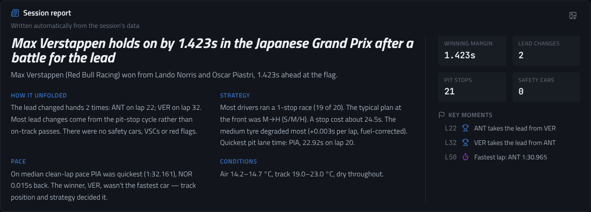

Under the hero sits an **automatic session report**: a headline, how the race unfolded, strategy, pace and conditions, with the key moments down the side. It's written from the data, so every figure can be checked on the other pages.

</details>

<details open>
<summary><b>Ask the pit wall</b> — an AI race engineer that shows its working</summary>
<br>

<a id="ask-the-pit-wall"></a>

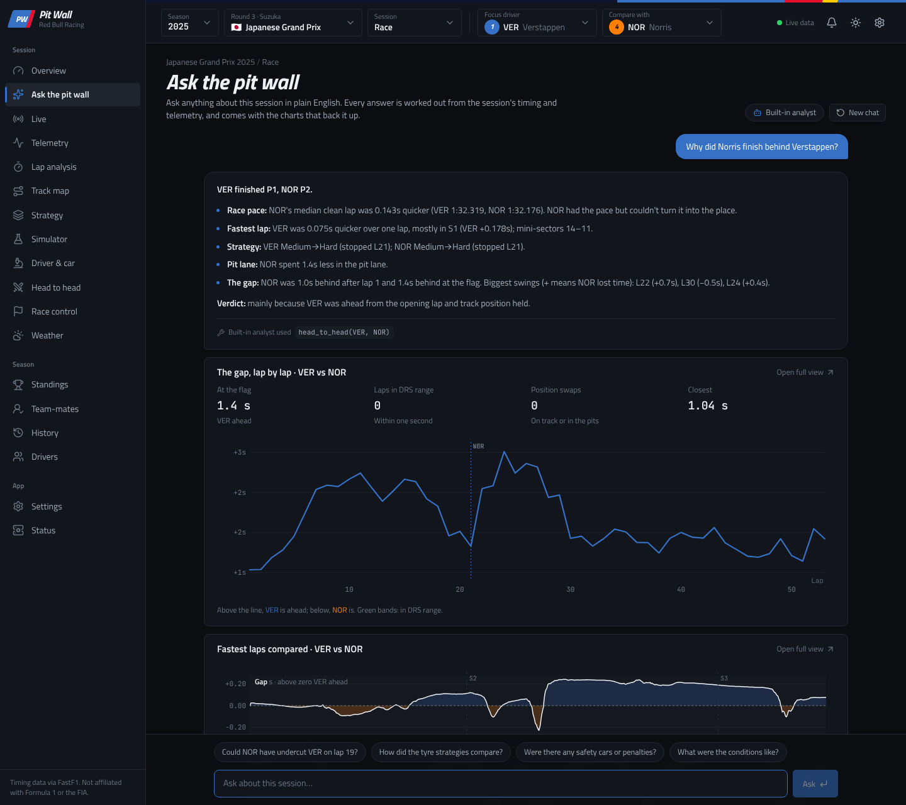

- Ask in plain English: *why did one driver beat another, where was the lap won, would the undercut have worked, were there any penalties, what was the weather like*.
- The analyst answers by calling **11 tools** over the session's data — head-to-head, lap comparison, strategy, race control, pace, degradation, the undercut simulator, weather and the championship. Every number in the answer comes from a tool, never from memory.
- Each answer comes with **the dashboard charts that back it up** (gap battle, telemetry overlay, strategy chart, undercut projection…), each linking to its full page.
- Suggested follow-ups skip anything already covered, however it was worded.
- **No API key needed.** Without a language model, a built-in rule-based analyst recognises the question, calls the same tools and writes the answer from templates. Set `PITWALL_LLM_PROVIDER` to `anthropic` (Claude) or `openai` (OpenAI, Meta's Llama API, Groq, a local Ollama…) and a model takes over the reasoning, falling back to the built-in analyst if it is unreachable.

</details>

<details>
<summary><b>Live race centre</b> — live timing, pit windows and win chances</summary>
<br>

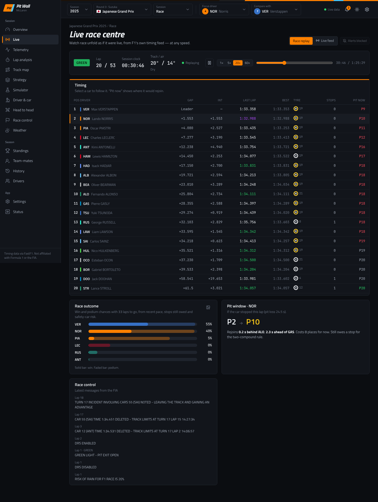

- Streams F1's live-timing feed over a WebSocket during a session, or replays any past race **exactly as it was broadcast** at 1–60× with pause and seek.
- Timing tower with gaps, intervals, last and best laps in timing colours, tyres and stops.
- **Pit now**: where every car would rejoin if it stopped this lap, and who it would be next to.
- **Win and podium probability**, re-run every lap as a Monte Carlo over recent pace, stops still owed (the two-compound rule) and safety-car risk.
- Alerts for safety cars, red flags, restarts, lead changes, pit stops, fastest laps, retirements, penalties and investigations.

</details>

<details>
<summary><b>Strategy simulator</b> — re-run the race with a different tyre plan</summary>
<br>

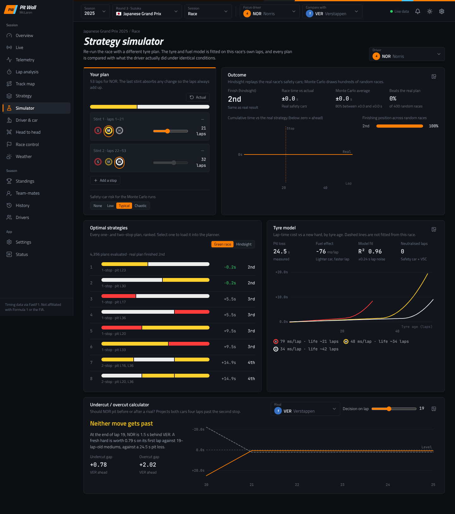

- Build any plan stint by stint and see the finishing position **with the real safety cars** (hindsight) and across **hundreds of random races** (Monte Carlo).
- The optimiser evaluates every one- and two-stop plan and ranks them; click one to load it.
- The **tyre model** shows each compound's pace offset, wear and cliff, fitted on this race's laps (with R² and lap noise).
- **Undercut / overcut calculator**: pick a rival and a lap and see whether pitting first, or staying out, would have won the place.

</details>

<details>
<summary><b>Driver &amp; car analysis</b> — style, ideal lap, car traits and tyre care</summary>
<br>

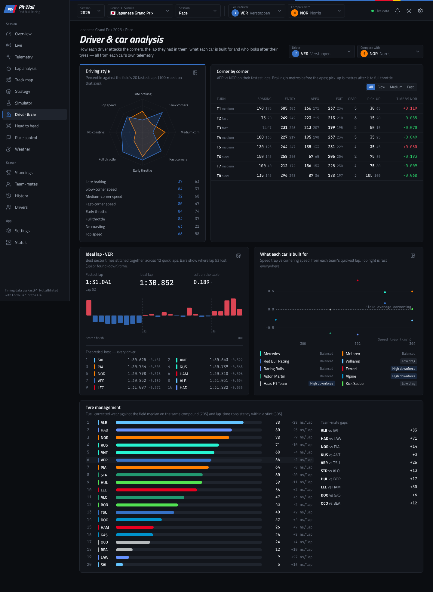

- **Driving style**: braking points, entry/apex/exit speeds and throttle pick-up for every corner, turned into a percentile fingerprint against the field.
- **Ideal lap**: the driver's best mini-sectors stitched together, showing how much was left on the table, plus the theoretical best for everyone.
- **What each car is built for**: speed-trap against cornering speed per team — low drag, high downforce or balanced.
- **Tyre management**: fuel-corrected wear against the field on the same compound, with team-mate gaps.

</details>

<details>
<summary><b>3D replay, onboard HUD and the battle view</b></summary>
<br>

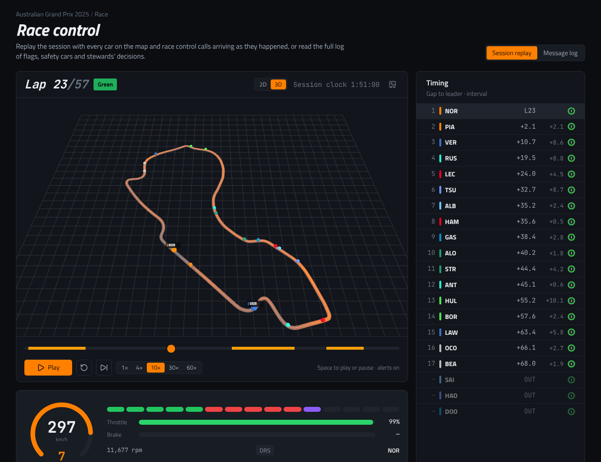

The race replay switches between the 2D map and a **3D track built from the cars' own position data, elevation included** (Three.js, orbit with the mouse). The **onboard HUD** below plays the focused car's speed, gear, RPM, throttle, brake and DRS in sync with the replay.

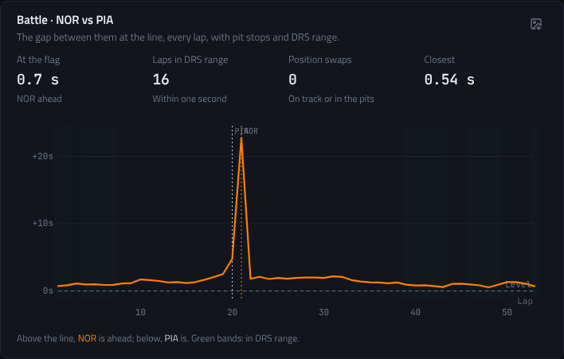

**Battle view** on the Head to head page: the gap between two drivers at the line every lap, with pit stops and DRS range marked. Every chart panel can also be exported as a share-ready image.

</details>

<details>
<summary><b>Team-mates</b>, <b>History</b> and <b>Status</b></summary>
<br>

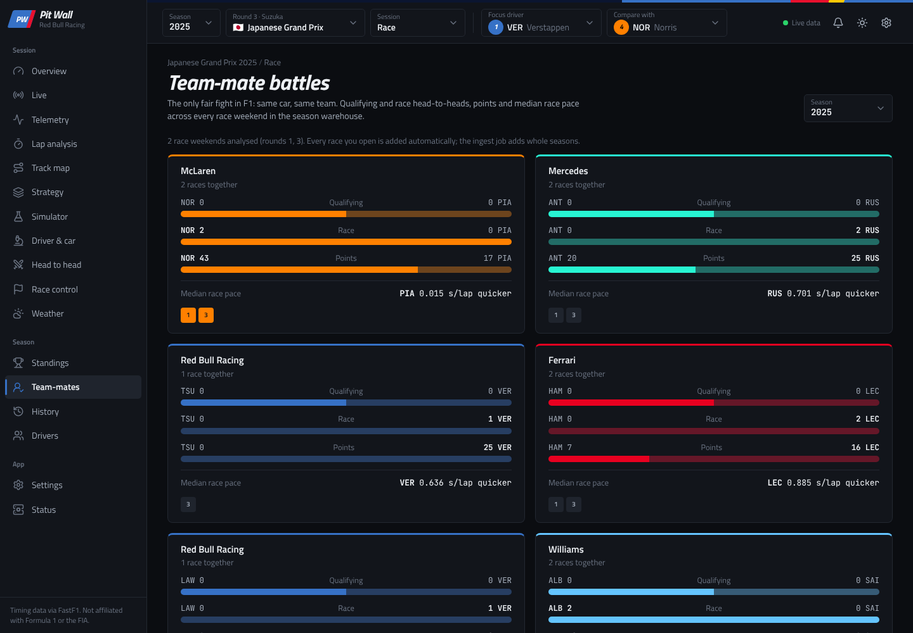

**Team-mates**: qualifying and race head-to-heads, points and median race pace for every pairing across the season, read from the Parquet warehouse.

**History**: every world champion since 1950, any driver's full career, and each circuit's pole times across the eras (from the Jolpica / Ergast archive, cached on disk).

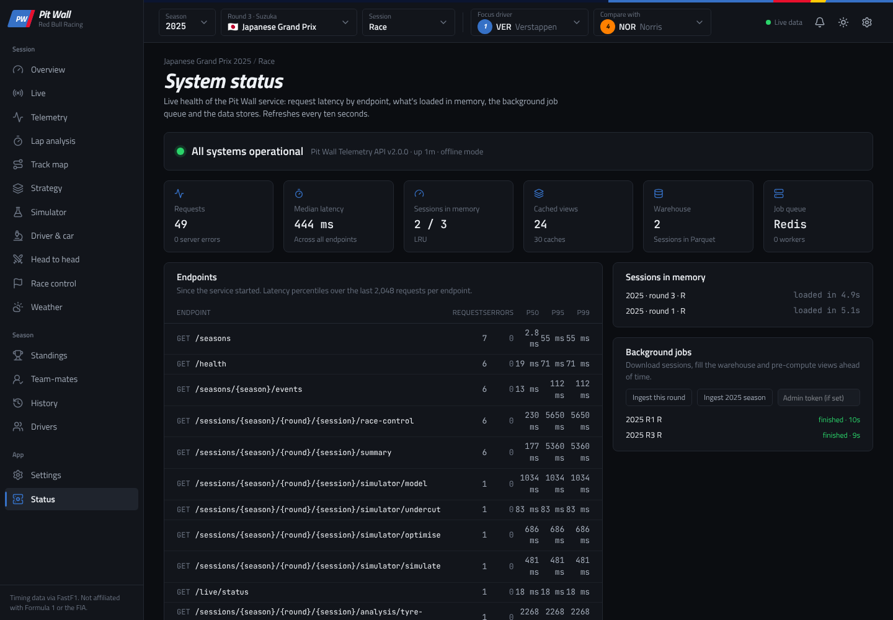

**Status**: requests, latency percentiles per endpoint, sessions in memory, cache and warehouse sizes, and the background job queue.

</details>

<details open>
<summary><b>Telemetry</b> — every channel the car logged, overlaid and synced to the map</summary>
<br>

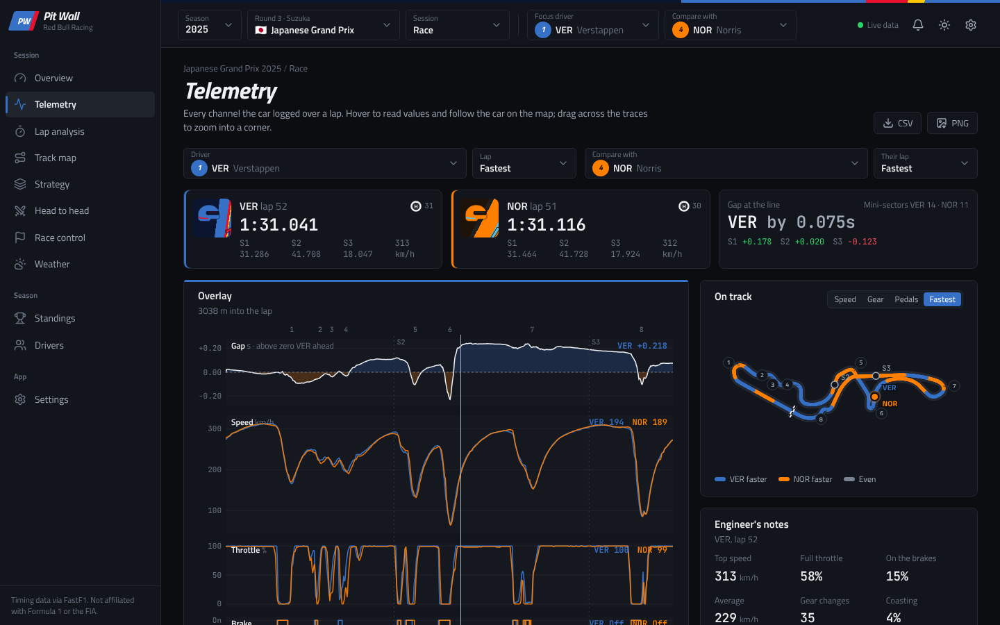

- Speed, throttle, brake, gear, RPM and DRS stacked on one distance axis, with a **gap trace** on top showing who is ahead at every metre.
- **Hover** to read every channel at that point — the cars move round the track map in step. **Drag** across the traces to zoom into a corner; double-click to reset.
- The map can be coloured by speed, gear, pedal use or **who was faster in each of 25 mini-sectors**.
- Corner apex speeds with gears, the heaviest braking zones (entry speed, minimum speed, g-force) and short engineer's notes.
- Export the lap as **CSV** or the traces as **PNG**.

</details>

<details>
<summary><b>Race control replay</b> — watch the session back with live alerts</summary>
<br>

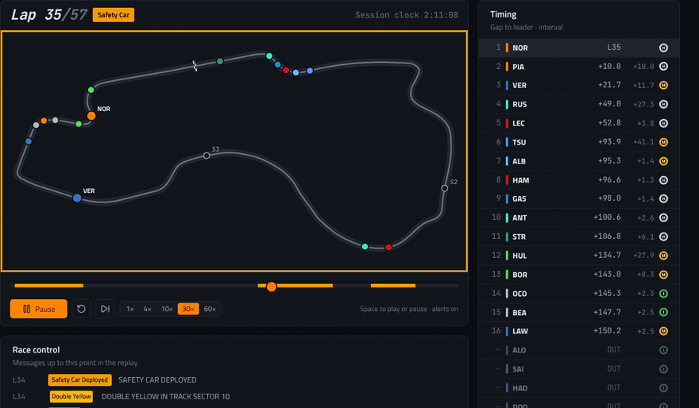

- Every car moves round the circuit on the racing line, sampled once a second and interpolated in between.
- The timing tower updates live: gap to leader, interval, current tyre, **PIT** and **OUT** markers.
- A banner and a coloured border show Green, Yellow, **Safety Car**, **VSC** and **Red Flag** periods; the scrubber is shaded where they happened.
- Race-control messages pop up as notifications as the clock passes them and collect in the bell menu. Choose which severities alert you in Settings.
- Play at 1×, 4×, 10×, 30× or 60×, jump a lap at a time, or press <kbd>Space</kbd> to play/pause.

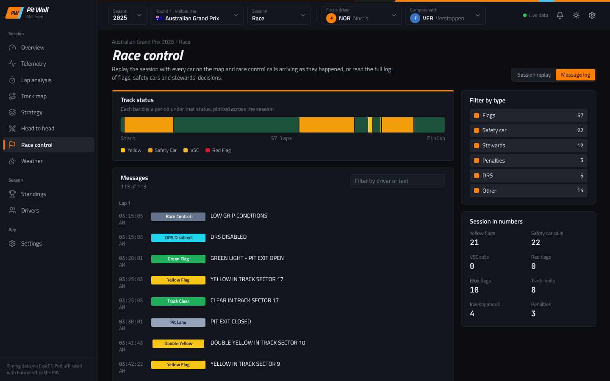

The **Message log** tab has every message grouped by lap with flag chips, filters by type and a track-status timeline across the whole session.

</details>

<details>
<summary><b>Strategy</b> — tyres, pit stops, degradation and the race trace</summary>
<br>

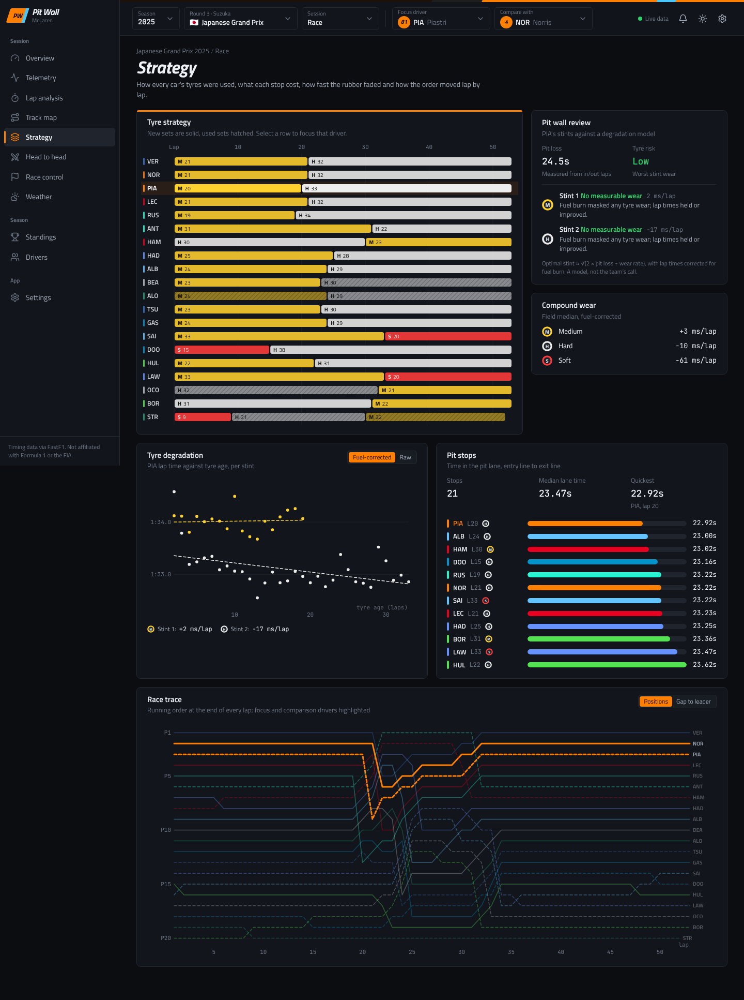

- One row per driver, each stint coloured by compound; used sets are hatched and SC/VSC laps are shaded.
- **Pit wall review**: each stint is checked against a degradation model using the pit loss measured from that race's in and out laps.
- Lap time against tyre age per stint, raw or fuel-corrected, with fitted lines and wear in ms per lap.
- Pit-lane times for every stop, and a race trace by position or gap to the leader.

</details>

<details>
<summary><b>Lap analysis</b> — the timing screen</summary>
<br>

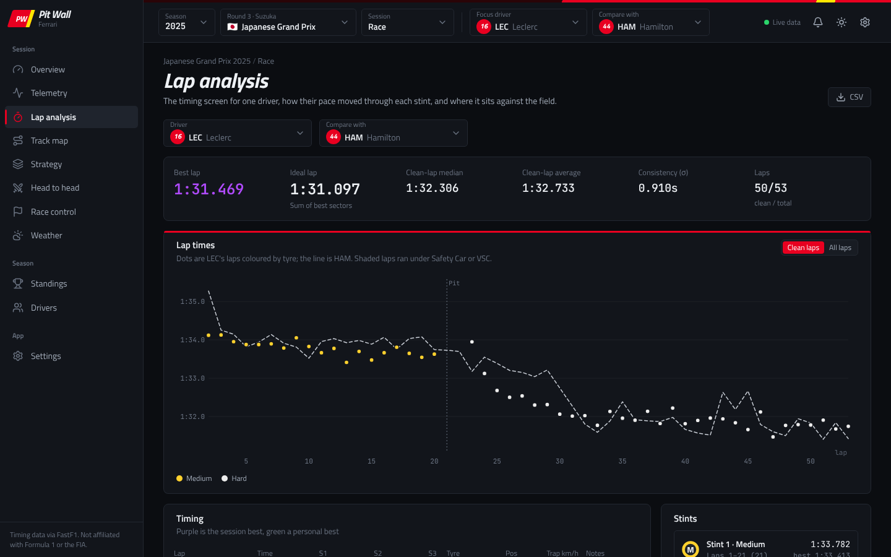

- Every lap with sectors in timing-screen colours: **purple** for the session best, **green** for a personal best.
- Lap times coloured by tyre, with the comparison driver drawn as a line, pit laps marked and SC/VSC laps shaded.
- Best, ideal (sum of best sectors), median, average and consistency.
- A field-pace box plot of every driver's clean green-flag laps.

</details>

<details>
<summary><b>Track map</b> — the lap drawn on the circuit</summary>
<br>

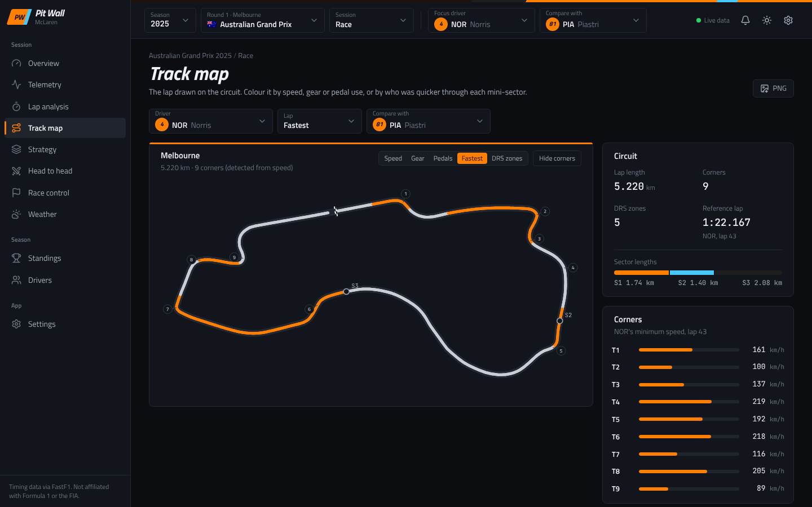

Colour the lap by speed, gear, pedal use, mini-sector dominance or DRS zones; read the circuit's length, sector lengths and corner apex speeds. Hover a corner in the list to find it on the map.

</details>

<details>
<summary><b>Head to head</b> — data-driven driver ratings</summary>
<br>

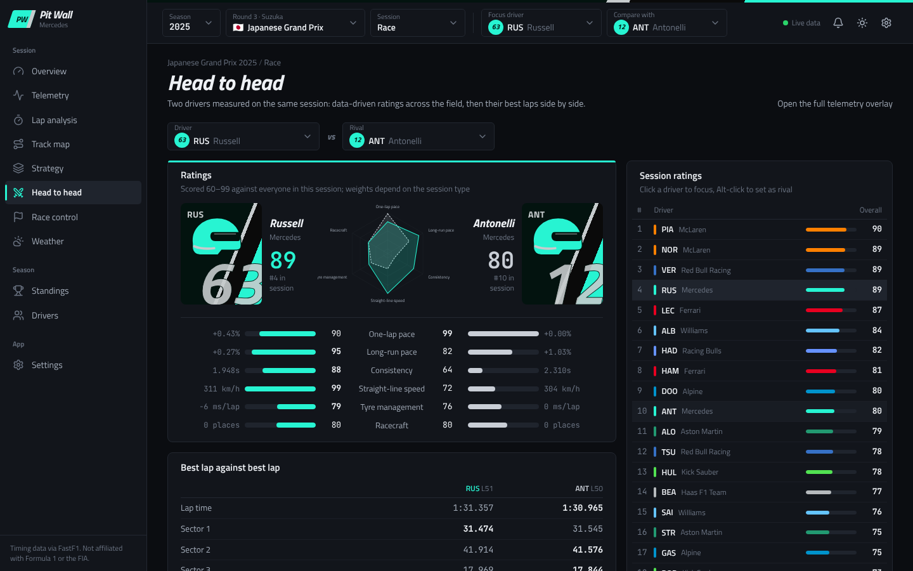

Every driver in the session is scored from 60 to 99 on one-lap pace, long-run pace, consistency, straight-line speed, tyre management and racecraft, then two drivers are compared on a radar, metric by metric, and on their best laps. *Alt-click* a driver in the leaderboard to make them the rival.

</details>

<details>
<summary><b>Weather</b>, <b>Standings</b>, <b>Drivers</b> and <b>Settings</b></summary>
<br>

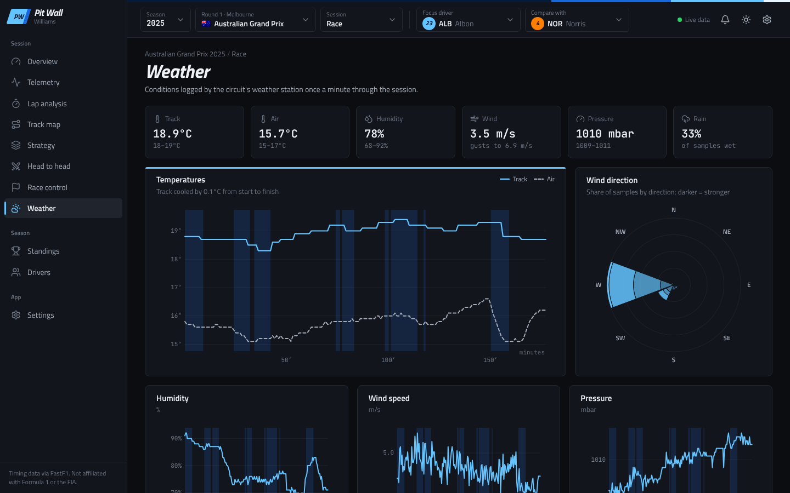

Track and air temperature, humidity, wind and pressure through the session, rain periods shaded, and a wind rose.

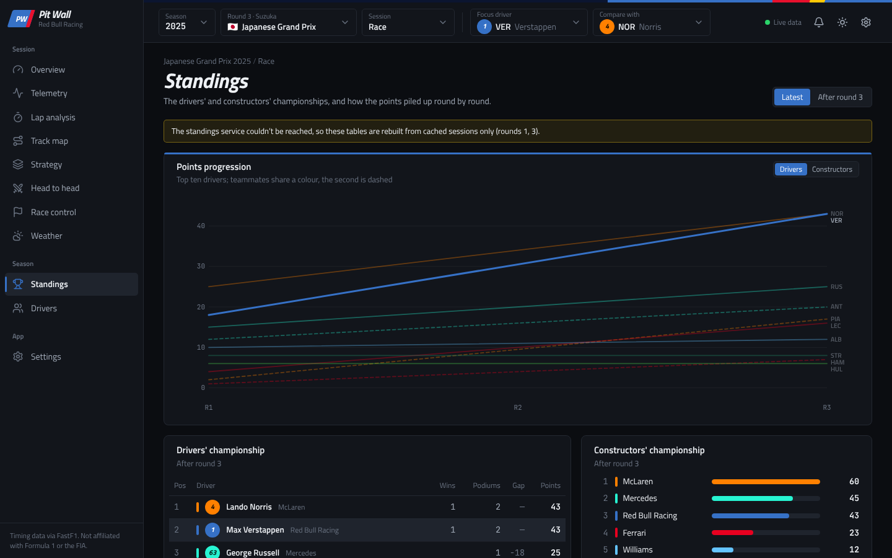

Drivers' and constructors' tables, points progression round by round, latest or after the selected round.

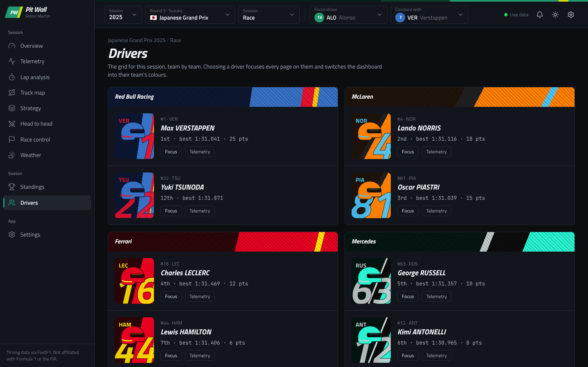

The grid team by team. Each driver has a photo slot — see [Driver photos](#driver-photos).

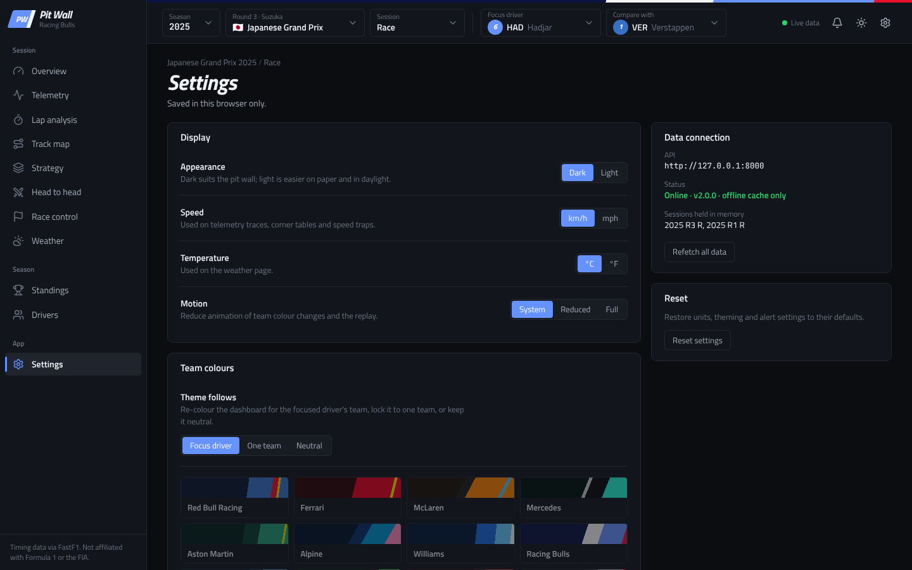

Units, dark/light mode, team theming (follow the focused driver, lock to one team, or neutral), replay alerts and API status.

</details>

<details>
<summary><b>Light mode</b> and <b>phones</b></summary>
<br>

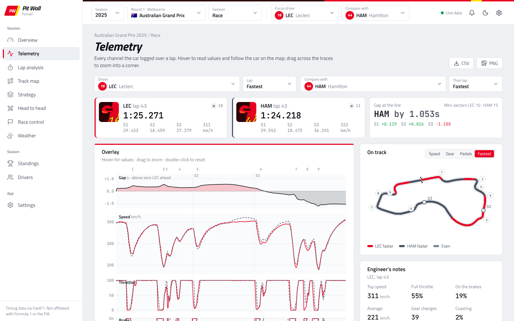

<p align="center">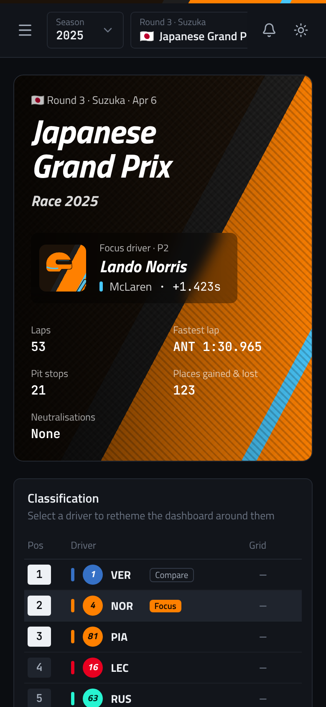</p>

</details>

---

## ⚙ How it works

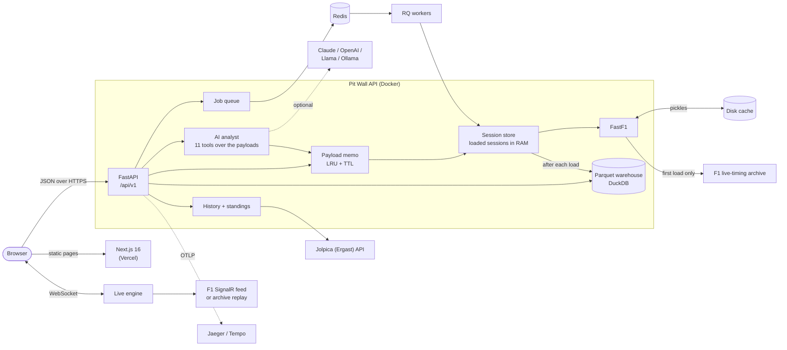

<details>
<summary><b>What happens on a request</b></summary>
<br>

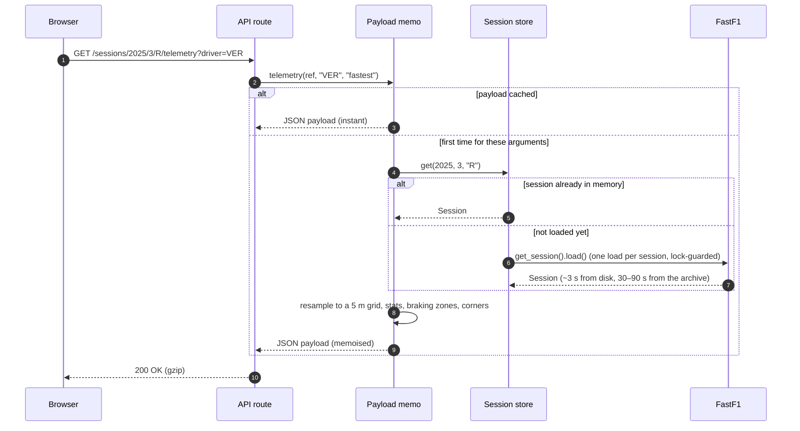

- Each session is loaded **once** and shared by every endpoint; concurrent requests for the same session wait on one lock instead of loading it twice.
- Derived payloads are memoised per argument tuple, so revisiting any view is instant.
- Errors come back as `{ "error": { "code", "message", "hint" } }` with proper 404 / 422 / 503 status codes, and the UI shows the message and hint.

</details>

<details>
<summary><b>How the AI analyst answers a question</b></summary>
<br>

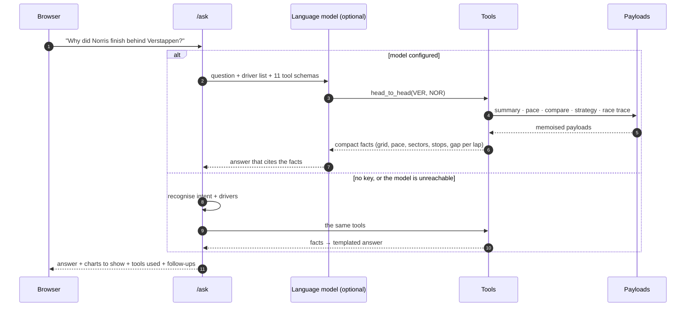

- The tools return small, sign-annotated summaries (e.g. *"positive means VER was quicker"*), never raw telemetry, so prompts stay short and the model has nothing to misread.
- The model talks to providers over plain HTTP in two wire formats — Anthropic Messages and OpenAI Chat Completions — which covers Claude, OpenAI, Meta's Llama API, Groq, Together, vLLM and a local Ollama.
- Reports are always built from templates first; a model may only rewrite the prose from the same JSON facts, and the template is kept if its output doesn't parse.

</details>

<details>
<summary><b>Season warehouse, jobs and observability</b></summary>
<br>

- **Warehouse.** Every loaded session is flattened into two small Parquet tables (results, laps), partitioned `season=/round=/session=` so **DuckDB** can prune partitions. Season-wide pages such as Team-mates are plain SQL over all of them, with no FastF1 sessions loaded.
- **Jobs.** With `REDIS_URL` set, downloads, warehouse ingest and cache warming go to Redis and run in separate **RQ workers** (`docker compose up --scale worker=3`). Without Redis, the same jobs run on a thread pool inside the API, so `uvicorn` alone still works.
- **Observability.** Per-route counters and latency percentiles are always on (`/api/v1/status`, Prometheus at `/metrics`). Set `OTEL_EXPORTER_OTLP_ENDPOINT` and every request, session load and job becomes an **OpenTelemetry** span (Jaeger is included as a Compose profile).

</details>

<details>
<summary><b>Frontend architecture</b></summary>
<br>

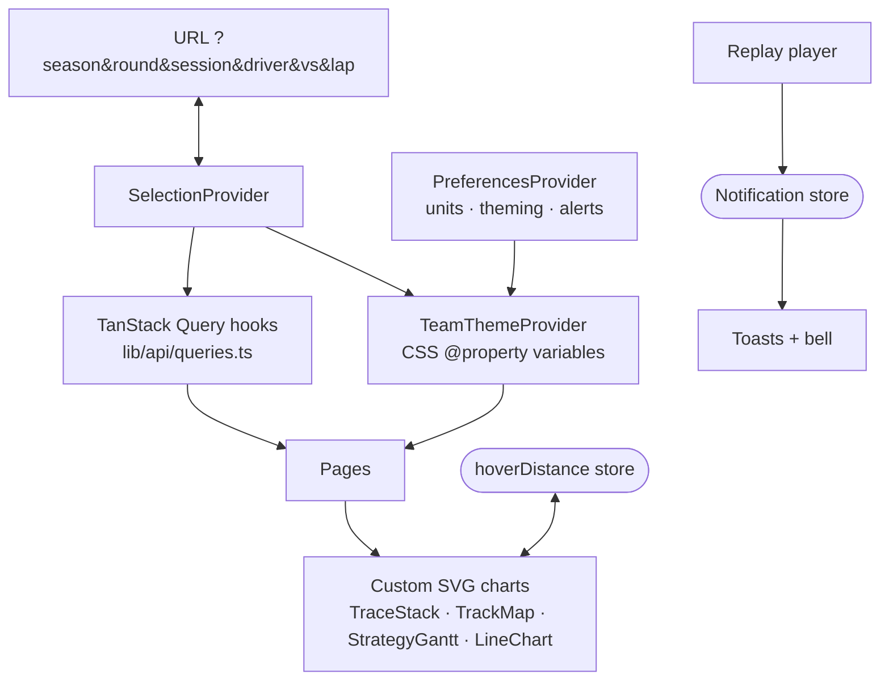

- **Selection** lives in the URL; missing values resolve to the latest completed race, its winner and runner-up.
- **Team themes** are pushed into CSS custom properties registered with `@property`, so a team change animates instead of snapping. Only colours and abstract livery stripes are used — no logos.
- **Charts** are written from scratch in SVG (scales, ticks, paths, tooltips). The telemetry traces and the track map share a tiny external store for the hovered distance, so hovering doesn't re-render the page.

</details>

---

## 🧮 The analytics, explained

<details>
<summary><b>Lap delta and mini-sectors</b></summary>
<br>

Both laps are resampled onto the same 5 m distance grid (the second lap is mapped by *relative* distance, because recorded lap lengths differ by a few metres). Each driver's clock is stretched so the lap spans exactly the official lap time, which removes the drift from car-data sampling. The gap at distance $d$ is

$$\Delta(d) = t_B(d) - t_A(d)$$

so a positive value means driver A is ahead. The lap is then cut into 25 equal mini-sectors and each is awarded to whoever covered it faster.

</details>

<details>
<summary><b>Fuel-corrected tyre degradation</b></summary>
<br>

Only representative laps are used: timed, no in/out laps, no SC/VSC/red-flag laps, not deleted, and within 107% of the driver's best. Burning fuel makes the car roughly 0.035 s/lap faster, which hides tyre wear, so lap times are corrected before fitting a line against tyre age:

$$t^{\text{corr}}_i = t_i + 0.035 \cdot (\text{lap}_i - \text{lap}_0)$$

The slope of that line is the wear rate $k$ in seconds per lap of tyre age.

</details>

<details>
<summary><b>Pit loss and the optimal stint</b></summary>
<br>

Pit loss $P$ is measured from the race itself: the in-lap plus the out-lap minus two of that driver's median clean laps, taken as the median over all green-flag stops.

With linear wear, a stint of $n$ laps costs $\tfrac{k n^2}{2}$ in tyre loss plus one stop. Minimising the time lost per lap, $\tfrac{P}{n} + \tfrac{k n}{2}$, gives

$$n^* = \sqrt{\frac{2P}{k}}$$

Each stint is then labelled *on target*, *ran long*, *stopped early*, *tyres not limiting* or *no measurable wear*. It is a model, not the team's call — undercuts, traffic and the two-compound rule all matter.

</details>

<details>
<summary><b>Driver ratings (60–99)</b></summary>
<br>

| Metric | Measured as | Better |
| --- | --- | --- |
| One-lap pace | Best lap vs session best (%) | Lower |
| Long-run pace | Median clean lap vs the best median (%) | Lower |
| Consistency | Interquartile range of clean laps (s) | Lower |
| Straight-line speed | Highest speed-trap reading | Higher |
| Tyre management | Mean fuel-corrected wear across stints | Lower |
| Racecraft | Places gained from lap 1 to the flag (finishers only) | Higher |

Each metric is mapped linearly from the worst driver (60) to the best (99) in that session, then weighted by session type (races weight long-run pace and tyres; qualifying weights one-lap pace and top speed). Drivers with too few representative laps get no overall rating instead of an extreme one.

</details>

<details>
<summary><b>The strategy simulator's tyre model</b></summary>
<br>

The model is fitted with ordinary least squares on the race's own clean green-flag laps:

$$t = \text{pace}_{d} + \text{offset}_{c} + w_{c}\cdot\text{age} + f\cdot\text{lap} \;(+\;\text{cliff}_{c}\text{ beyond the compound's life})$$

The driver term absorbs car and driver speed, so compound offsets and wear rates $w_c$ are shared across the field (more data per term, less noise); $f$ is the lap-time gain per lap as fuel burns off. Compounds nobody raced fall back to typical Pirelli-range priors and are flagged.

A plan is simulated **relative to what the driver actually did**: both the plan and the real strategy run through the same model under the same conditions, and the difference is added to the real race time. Start losses, traffic and slow stops cancel out, and the projected position is read off against every other car's real race time. *Hindsight* uses the real safety-car laps; *Monte Carlo* draws random neutralisations and lap noise hundreds of times.

</details>

<details>
<summary><b>Live win probability and the pit window</b></summary>
<br>

On every timing update, each car's remaining race is simulated many times from its recent clean-lap pace and spread, the stops it still owes (a dry race must use two compounds) and a per-lap chance of a safety car that bunches the field. Win and podium chances are the share of simulations each car finishes P1 or in the top three.

**Pit now** adds the measured pit loss to the car's gap to the leader and finds where that lands in the current order: the rejoin position, the cars either side and the gaps to them.

</details>

<details>
<summary><b>Session replay</b></summary>
<br>

Streaming raw X/Y positions for 20 cars would be large, and straight-line interpolation cuts corners. Instead, each car's position is sent as **progress**: completed laps plus the fraction of the current lap, measured by integrated distance between that lap's start and end timestamps. The browser maps the fraction back onto the circuit outline, so cars always follow the racing line. Gaps are the time since the race leader passed the same point.

</details>

---

## 🔌 API reference

Interactive docs live at **`/docs`** (Swagger) once the API is running.

<details>
<summary><b>Endpoints</b></summary>
<br>

**Calendar and championship**

| Method | Path | Returns |
| --- | --- | --- |
| GET | `/api/v1/health` | Status, version, sessions loaded in memory |
| GET | `/api/v1/seasons` | Supported seasons and the default |
| GET | `/api/v1/seasons/{season}/events` | Calendar with sessions and status, next and last events |
| GET | `/api/v1/seasons/{season}/events/{round}` | One event |
| GET | `/api/v1/seasons/{season}/standings?round=` | Driver and constructor standings with points progression |

**Session** — prefix `/api/v1/sessions/{season}/{round}/{session}`, where `session` is one of `FP1 FP2 FP3 Q SQ SS S R`

| Path | Query | Returns |
| --- | --- | --- |
| `/summary` | | Event, drivers, classification, highlights, weather snapshot |
| `/drivers` | | Drivers with team and team colour |
| `/results` | | Classification |
| `/laps` | `driver` | Every lap with graded sectors, tyres, flags; stats and stints |
| `/pace` | | Clean-lap distribution for every driver |
| `/circuit` | | Outline, corners, sectors, DRS zones, rotation |
| `/telemetry` | `driver`, `lap` (number or `fastest`) | Distance-resampled channels, stats, braking zones, corners, insights |
| `/compare` | `driver_a`, `lap_a`, `driver_b`, `lap_b` | Both laps on one grid, delta, sector deltas, mini-sectors |
| `/strategy` | | Stints, pit stops, measured pit loss, compound wear |
| `/race-trace` | | Position and gap to leader per lap, track status per lap |
| `/degradation` | `driver` | Per-stint lap times vs tyre age with raw and fuel-corrected fits |
| `/recommendation` | `driver` | Pit-wall review of each stint |
| `/race-control` | | Classified messages, counts, track-status timeline |
| `/weather` | | Time series, summary, wind rose, rain periods |
| `/ratings` | | 60–99 ratings for every driver |
| `/replay` | `step` (s, default 1) | Every car's progress on a fixed clock, pits, stints |
| `/replay/onboard` | `driver`, `step` | One car's dashboard channels on the replay clock |
| `/circuit/3d` | | Track outline with elevation (m) |
| `/report` | `narrate` | Automatic session report: headline, sections, key moments, stats |
| `/ask` (POST) | `{question, history}` | Answer, charts that back it, tools used, follow-ups |
| `/ask/suggestions` | | Starter questions and which analyst is active |
| `/simulator/model` | `driver` | Fitted tyre and fuel model |
| `/simulator/simulate` | `driver`, `plan`, `sc`, `vsc` | Hindsight and Monte Carlo outcome of a plan |
| `/simulator/optimise` | `driver`, `conditions` | Every one- and two-stop plan, ranked |
| `/simulator/undercut` | `attacker`, `defender`, `lap` | Undercut vs overcut projection and verdict |
| `/analysis/style` | `drivers` | Corner metrics and style percentiles |
| `/analysis/ideal-lap` | `driver` | Best mini-sectors stitched together |
| `/analysis/cars` | | Straight-line vs cornering speed per team |
| `/analysis/tyre-management` | | Wear vs the field on the same compound |

**Season, history, live and operations**

| Method | Path | Returns |
| --- | --- | --- |
| GET | `/api/v1/seasons/{season}/teammates` | Team-mate head-to-heads from the warehouse |
| GET | `/api/v1/history/champions` · `/drivers` · `/drivers/{id}` · `/circuits` · `/circuits/{id}` | Champions, careers and circuits since 1950 |
| WS | `/api/v1/live/ws?mode=archive&season=&round=&session=&speed=` | Live snapshots, odds, pit windows and alerts (`mode=live` for the real feed) |
| GET | `/api/v1/ai/status` | Which language model, if any, is configured |
| POST | `/api/v1/jobs/ingest` | Queue downloads / warehouse ingest (`X-Admin-Token` if set) |
| GET | `/api/v1/status` · `/metrics` | Service health and latency · Prometheus metrics |

The full, generated reference is in [`docs/API.md`](docs/API.md), and a typed Python client lives in [`sdk/python`](sdk/python).

</details>

<details>
<summary><b>Try it</b></summary>
<br>

```bash
# Winner, podium and highlights of the 2025 Japanese GP
curl "http://127.0.0.1:8000/api/v1/sessions/2025/3/R/summary"

# Verstappen's fastest lap against Norris's
curl "http://127.0.0.1:8000/api/v1/sessions/2025/3/R/compare?driver_a=VER&driver_b=NOR"

# Ask the pit wall
curl -X POST "http://127.0.0.1:8000/api/v1/sessions/2025/3/R/ask" \
     -H "content-type: application/json" \
     -d '{"question": "Could Norris have undercut Verstappen on lap 19?"}'

# Errors carry a hint
curl "http://127.0.0.1:8000/api/v1/sessions/2025/3/R/telemetry?driver=VER&lap=999"
# {"error":{"code":"not_found","message":"VER has no lap 999.","hint":"Laps 1–53 are available."}}
```

</details>

---

## 💻 Run it locally

Requires **Python 3.11+** and **Node 20.9+**. Open two terminals in the project folder.

<details open>
<summary><b>Windows (PowerShell)</b></summary>
<br>

```powershell
# Terminal 1 — API
cd backend
python -m venv .venv
.venv\Scripts\activate
pip install -r requirements-dev.txt
uvicorn app.main:app --reload        # http://127.0.0.1:8000/docs
```

```powershell
# Terminal 2 — web
cd frontend
npm install
npm run dev                          # http://localhost:3000
```

If activation is blocked, run `Set-ExecutionPolicy -Scope CurrentUser RemoteSigned` once.

</details>

<details>
<summary><b>macOS / Linux</b></summary>
<br>

```bash
# Terminal 1 — API
cd backend
python3 -m venv .venv && source .venv/bin/activate
pip install -r requirements-dev.txt
uvicorn app.main:app --reload

# Terminal 2 — web
cd frontend
npm install && npm run dev
```

</details>

<details>
<summary><b>Docker (both together)</b></summary>
<br>

```bash
docker compose up --build            # web on :3000, API on :8000
```

The FastF1 cache is mounted from `./cache`; make sure the container can write to it.

</details>

<details>
<summary><b>Tests and checks</b></summary>
<br>

```bash
cd backend && ruff check . && pytest              # runs offline against ./cache
cd frontend && npm run lint && npm run typecheck && npm run build
cd frontend && npm run test:e2e                   # Playwright: every page + key flows
cd sdk/python && pytest
```

GitHub Actions runs all of these on every push and pull request.

</details>

> [!NOTE]
> The first time a session is opened, FastF1 downloads it from the F1 live-timing archive (30–90 s). After that it loads from `cache/` in a few seconds.

---

## 🚀 Deploy

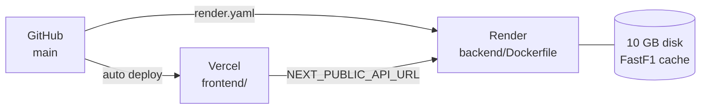

1. **API → Render.** New → Blueprint → pick this repo; `render.yaml` sets up the Docker service, health check and a persistent disk for the cache. Use at least the **Starter** plan — a loaded race needs a few hundred MB of RAM. Set `CORS_ORIGINS` to your Vercel URL. (Railway, Fly.io and Hugging Face Spaces work too with `backend/Dockerfile`; mount a volume at `/data/fastf1-cache`.)
2. **Web → Vercel.** Import the repo, set **Root Directory** to `frontend`, add `NEXT_PUBLIC_API_URL=https://<your-api-host>`, deploy. Every page is statically prerendered and calls the API from the browser.

<details>
<summary><b>Backend environment variables</b></summary>
<br>

| Variable | Default | Purpose |
| --- | --- | --- |
| `F1_CACHE_DIR` | `../cache` | FastF1 on-disk cache |
| `F1_SESSION_CACHE_SIZE` | `3` | Fully loaded sessions kept in memory |
| `F1_SEASONS` | `2023,2024,2025,2026` | Seasons the API exposes |
| `F1_DEFAULT_SEASON` | `2025` | Season the dashboard opens on |
| `CORS_ORIGINS` | `http://localhost:3000` | Allowed frontend origins (comma separated) |
| `CORS_ORIGIN_REGEX` | `https://.*\.vercel\.app` | Extra allowed origins (Vercel previews) |
| `F1_OFFLINE` | `0` | Serve cached sessions only, never hit the network |
| `JOLPICA_BASE_URL` | `https://api.jolpi.ca/ergast/f1` | Standings and history source |
| `PITWALL_LLM_PROVIDER` | *(unset)* | `anthropic` or `openai` (any OpenAI-compatible API) for the AI analyst; unset uses the built-in analyst |
| `PITWALL_LLM_API_KEY` | *(unset)* | Provider key (falls back to `ANTHROPIC_API_KEY` / `OPENAI_API_KEY`) |
| `PITWALL_LLM_MODEL` | `claude-sonnet-5-5` / `gpt-4.1-mini` | Model name, e.g. `llama3.1` for Ollama |
| `PITWALL_LLM_BASE_URL` | provider default | e.g. `http://localhost:11434/v1` for a local Ollama |
| `REDIS_URL` | *(unset)* | Send background jobs to Redis / RQ workers |
| `PITWALL_ADMIN_TOKEN` | *(unset)* | Protects `POST /jobs/*` |
| `F1_WAREHOUSE_DIR` | `data/warehouse` | Parquet season warehouse |
| `OTEL_EXPORTER_OTLP_ENDPOINT` | *(unset)* | Export OpenTelemetry traces |

</details>

---

## 📁 Project layout

<details>
<summary><b>Show the tree</b></summary>
<br>

```
.
├── backend/                     FastAPI + FastF1
│   ├── app/
│   │   ├── ai/                  race reports, the analyst's tools, LLM clients, agent
│   │   ├── core/                settings, errors, memoisation, FastF1 setup, observability
│   │   ├── data/                season calendars, in-memory session store
│   │   ├── live/                live-timing sources, engine, odds and pit windows
│   │   ├── jobs/                Redis/RQ queue, tasks and worker
│   │   ├── warehouse/           Parquet + DuckDB season store
│   │   ├── services/            results · laps · telemetry · circuit · strategy · simulator
│   │   │                        analysis · race_control · weather · ratings · replay
│   │   │                        standings · season · history
│   │   ├── schemas/             Pydantic response models
│   │   ├── api/                 v1 routers, request deps, memoised payload layer
│   │   └── main.py              app factory (CORS, gzip, error handlers)
│   ├── scripts/                 API reference generator
│   ├── tests/                   pytest suite (offline, against ../cache)
│   └── Dockerfile
├── frontend/                    Next.js 16 · Tailwind 4 · TanStack Query
│   ├── app/                     one folder per page
│   ├── components/
│   │   ├── ai/                  session report, answer charts, safe Markdown
│   │   ├── charts/              TraceStack, TrackMap, Track3D, StrategyGantt, battle, undercut, radar…
│   │   ├── replay/              session replay player and onboard HUD
│   │   ├── shell/               layout, pickers, notifications
│   │   ├── session/             hero, classification, season widgets
│   │   ├── f1/                  tyres, flags, timing cells, driver avatars
│   │   └── ui/                  panel, picker, primitives
│   ├── lib/                     API client and hooks, team registry, formatting
│   ├── state/                   URL selection, preferences, theme, notifications, live
│   ├── e2e/                     Playwright functional and visual tests
│   └── public/drivers/          optional driver photos + manifest.json
├── sdk/python/                  pitwall-client: typed sync/async Python client
├── cache/                       FastF1 cache (two 2025 races included for offline tests)
├── docs/                        API reference, OpenAPI schema, architecture notes, screenshots
├── notebooks/, src/             original exploration notebooks and helpers
├── render.yaml                  Render blueprint for the API
└── docker-compose.yml           web, API, Redis, workers (+ Jaeger profile)
```

</details>

### Driver photos

Photos are opt-in. Add images you have the rights to use to `frontend/public/drivers/` and map driver codes to files in `frontend/public/drivers/manifest.json`:

```json
{ "VER": "VER.webp", "NOR": "NOR.webp" }
```

Drivers without a photo get a generated card in their team's colours with their race number.

---

## 🛣 Roadmap

- [x] Multi-season API with in-memory session store and memoised payloads
- [x] Telemetry overlay, gap trace, mini-sectors, corner and braking analysis
- [x] Tyre strategy, measured pit loss, fuel-corrected degradation, stint review
- [x] Session replay with live race-control notifications
- [x] Team theming for every 2023–2026 constructor, dark/light mode
- [x] Docker, Render and Vercel configs, CI
- [x] Strategy simulator: fitted tyre model, Monte Carlo races, optimiser, undercut calculator
- [x] Live race centre: live-timing WebSocket, win odds, pit windows, alerts
- [x] Driver & car analysis: driving style, ideal lap, car traits, tyre management
- [x] 3D elevation track, onboard HUD, battle view, shareable chart images
- [x] AI layer: Ask the pit wall and automatic session reports
- [x] History since 1950, Parquet/DuckDB warehouse, Redis workers, tracing, status page
- [x] Playwright e2e and visual tests, Python SDK, generated API reference
- [ ] Qualifying knockout view (Q1/Q2/Q3 cut-off lines)
- [ ] More than two drivers on the telemetry overlay
- [ ] Voice questions in Ask the pit wall

---

<div align="center">
<sub>Timing data via <a href="https://docs.fastf1.dev">FastF1</a> and <a href="https://github.com/jolpica/jolpica-f1">Jolpica</a>. Not affiliated with Formula 1, the FIA or any team. Built by Asish Kumar Patra.</sub>
</div>
