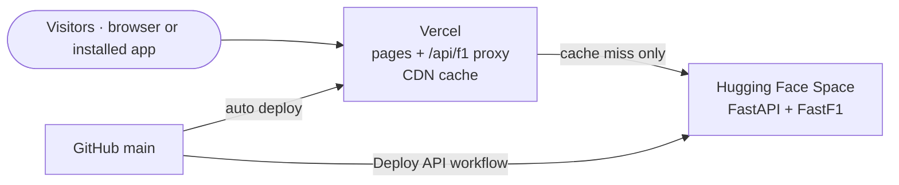

# Deploying Pit Wall

The app runs as two pieces:

| Piece | Where | Cost | What it does |
| --- | --- | --- | --- |
| **Website** (`frontend/`) | Vercel | Free | Serves the pages worldwide and proxies data requests through `/api/f1`, caching finished sessions on Vercel's CDN |
| **Data API** (`backend/`) | Hugging Face Spaces (Docker) | Free — 2 vCPU, 16 GB RAM | Loads sessions with FastF1 and computes every chart's data |

Why it's fast:

- **CDN caching.** A finished session never changes, so the API marks its responses cacheable for 30 days. The first visitor to open a chart triggers the computation; everyone after that, anywhere in the world, gets it from the nearest Vercel edge in milliseconds.
- **In-memory sessions.** On the Space, up to 16 loaded sessions stay in RAM, so switching drivers, laps and pages within a session is instant.
- **Warm-up.** When the API starts, it pre-loads the latest two races and qualifying sessions in the background.
- **Installed app.** The service worker keeps the app shell and every session you've opened on your device, so repeat visits open instantly and work offline.

---

## 1. Data API on Hugging Face (about 10 minutes)

1. Create a free account at [huggingface.co](https://huggingface.co/join).
2. Create the Space: [huggingface.co/new-space](https://huggingface.co/new-space)
   - **Space name:** `pitwall-api`
   - **SDK:** Docker → *Blank*
   - **Hardware:** CPU basic (free)
   - **Visibility:** Public
3. Create an access token: avatar → **Settings → Access Tokens → Create new token** → type **Write** → copy it.
4. In this GitHub repository open **Settings → Secrets and variables → Actions**:
   - **Secrets** tab → *New repository secret* → name `HF_TOKEN`, value: the token.
   - **Variables** tab → *New repository variable* → name `HF_SPACE`, value: `<your-hf-username>/pitwall-api`.
5. Open **Actions → Deploy API to Hugging Face → Run workflow**. It copies `backend/` into the Space; Hugging Face then builds the Docker image (5–8 minutes — watch the Space's **Logs** tab).
6. Check it: `https://<your-hf-username>-pitwall-api.hf.space/api/v1/health` should return `{"status":"ok", …}`.

From now on every push to `main` that touches `backend/` redeploys the Space automatically.

## 2. Website on Vercel (about 5 minutes)

1. Sign in to [vercel.com](https://vercel.com/signup) with GitHub.
2. **Add New → Project → Import** `F1-Telemetry-Dashboard-2025`.
3. **Root Directory:** click *Edit* and choose `frontend`. The framework is detected as Next.js.
4. **Environment Variables:** add
   - `PITWALL_API_ORIGIN` = `https://<your-hf-username>-pitwall-api.hf.space`
5. **Deploy.** You get a URL such as `https://f1-telemetry-dashboard-2025.vercel.app`.
6. Optional: **Settings → Domains** to pick a nicer `*.vercel.app` name or attach your own domain.

Every push to `main` redeploys the website automatically; pull requests get preview URLs.

## 3. Keep it awake (optional, recommended)

Free Spaces sleep after 48 hours without visitors and take about a minute to wake (the app shows a "waking up" message and retries by itself). To avoid that, add a repository **variable** `SITE_URL` = your Vercel URL. The **Keep API warm** workflow then pings the API twice a day.

## 4. Install it as an app

Open the website and:

- **Chrome / Edge (Windows, Mac, Linux, Android):** click **Install app** in the top bar, or the install icon in the address bar.
- **iPhone / iPad:** in Safari tap **Share → Add to Home Screen**.

It opens in its own window with the Pit Wall icon, and sessions you've viewed keep working offline.

---

## Troubleshooting

| Symptom | Fix |
| --- | --- |
| Pages say "data server is waking up" for over 2 minutes | Open the Space page on Hugging Face; if it shows *Runtime error*, check **Logs**, then *Factory rebuild* |
| Every chart errors | Check `PITWALL_API_ORIGIN` on Vercel has no trailing slash and starts with `https://`, then redeploy |
| Deploy API workflow skipped | The `HF_SPACE` variable is missing or misspelled |
| Deploy API workflow fails at "Push to the Space" | The token isn't a **Write** token, or the Space name doesn't match `HF_SPACE` |
| A brand-new race shows "not published yet" | F1 publishes timing data a while after the session; try again later |

## Other hosts

- **Render (paid, always on):** `render.yaml` in the repo root is a ready Blueprint (Standard plan, 2 GB RAM, persistent disk).
- **Any Docker host / VPS:** `docker compose up -d --build` runs both pieces; put a reverse proxy with HTTPS in front of port 3000.
