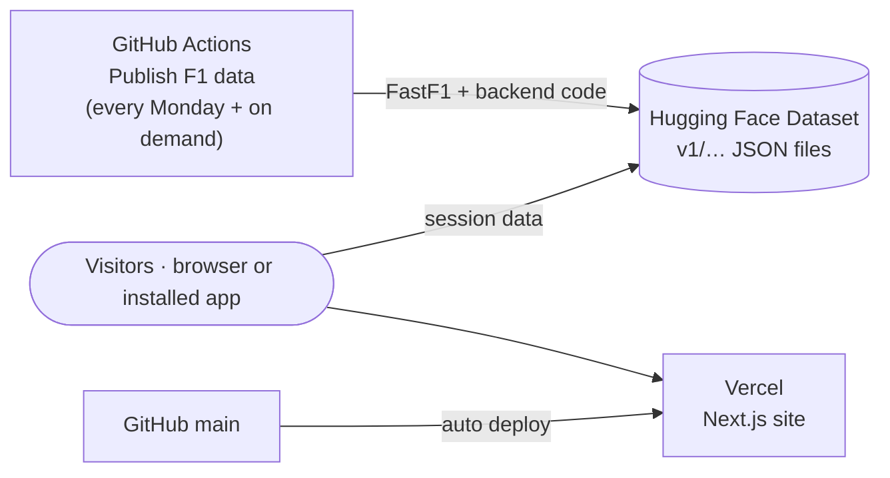

# Deploying Pit Wall (free, no card)

The public app needs **no running server**. Every chart's data is calculated ahead of time by GitHub Actions and published as files; the website reads those files directly.

| Piece | Where | Cost |
| --- | --- | --- |
| **Data** — every session from 2023 to 2026, pre-computed | Hugging Face **Dataset** (`<user>/pitwall-data`) | Free, no card |
| **Calculation** — downloads sessions with FastF1 and runs the backend code | GitHub Actions (**Publish F1 data** workflow) | Free for public repos |
| **Website** — pages, installable app | Vercel | Free, no card |

What this means for visitors:

- Pages and data come from global CDNs, so there is nothing to wake up and nothing to run out of memory.
- Telemetry uses each driver's **fastest lap** in every session (storing every lap of every driver would take gigabytes). Comparisons between any two drivers are calculated in the browser.
- New race weekends appear after the Monday run, or as soon as you start **Publish F1 data** by hand.

---

## 1. Hugging Face (5 minutes, free account only)

1. **Create a token:** avatar → **Settings → Access Tokens → + Create new token** → **Write** tab → name `github-publish` → **Create token** → copy it (starts with `hf_`).
2. That's all on Hugging Face — the dataset `pitwall-data` is created automatically by the first workflow run.

## 2. GitHub (3 minutes)

Open the repository → **Settings → Secrets and variables → Actions**:

1. **Secrets** tab → **New repository secret** → Name `HF_TOKEN`, Secret: the `hf_…` token → **Add secret**.
2. **Variables** tab → **New repository variable** → Name `HF_DATASET`, Value `<your-hf-username>/pitwall-data` → **Add variable**.

## 3. Publish the data (runs by itself, a few hours the first time)

1. **Actions → Publish F1 data → Run workflow** (keep the defaults: `2023 2024 2025 2026`).
2. Four jobs run in parallel, one per season. Each uploads after every race weekend, so data appears progressively at `https://huggingface.co/datasets/<your-hf-username>/pitwall-data`.
3. A job stops cleanly before GitHub's 6-hour limit if a season isn't finished. **Run the workflow again** and it continues where it stopped — already published sessions are skipped. Two runs normally cover all four seasons.
4. After that it runs every Monday on its own and adds new sessions only.

## 4. Website on Vercel (5 minutes)

1. Sign in to [vercel.com](https://vercel.com/signup) with GitHub (Hobby plan, free, no card).
2. **Add New → Project → Import** `F1-Telemetry-Dashboard-2025`.
3. **Root Directory:** *Edit* → `frontend`.
4. **Environment Variables:**
   - `NEXT_PUBLIC_DATA_URL` = `https://huggingface.co/datasets/<your-hf-username>/pitwall-data/resolve/main/v1`
5. **Deploy.** You get a public URL such as `https://f1-telemetry-dashboard-2025.vercel.app`; rename it under **Settings → Domains** if you like.

Every push to `main` redeploys the site. Changing an environment variable needs a redeploy (**Deployments → ⋯ → Redeploy**).

## 5. Install it as an app

- **Chrome / Edge (Windows, Mac, Android):** **Install app** in the top bar, or the install icon in the address bar.
- **iPhone / iPad:** Safari → **Share → Add to Home Screen**.

---

## Troubleshooting

| Symptom | Fix |
| --- | --- |
| Workflow jobs are skipped | The `HF_DATASET` variable is missing or misspelled |
| "Upload failed" in the workflow log | The token isn't a **Write** token, or `HF_DATASET` uses the wrong username |
| Site says "This hasn't been published yet" everywhere | The first workflow run hasn't uploaded anything yet, or `NEXT_PUBLIC_DATA_URL` is wrong — open `<DATA_URL>/seasons.json` in a browser to check |
| A recent race is greyed out in the race picker | It's published after the next Monday run; start **Publish F1 data** to add it now |
| A session failed to export | It's listed under `failed` in `v1/seasons/<year>/index.json` with the reason; the next run retries it |

## Running the full API instead (optional)

The FastAPI backend is still the source of all the numbers and runs locally (see the README). If you later want any-lap telemetry live, deploy `backend/` to a paid host — `render.yaml` (Render Standard) or the **Deploy API to Hugging Face** workflow (needs Hugging Face PRO) — set `PITWALL_API_ORIGIN` on Vercel and remove `NEXT_PUBLIC_DATA_URL`.
